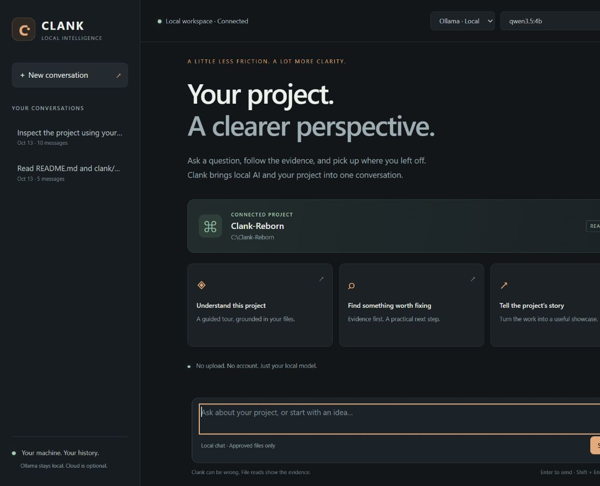
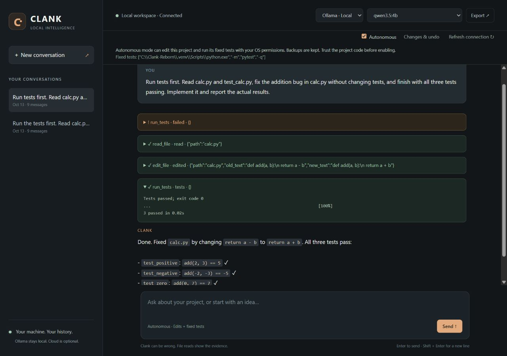

# Clank Reborn

Public-beta release candidate for trusted local projects. Windows/Ollama,
internet tools, and real edit/test/undo workflows have been exercised locally.
This is not a hardened unattended coding service; model quality still varies.

A small, local-first assistant for understanding a project through conversation.

Open the browser, choose an installed Ollama model, and ask about your code.
Clank can read approved project files, show its evidence, and save the
conversation locally so you can pick it up later.

One Python process. One base runtime dependency (`requests`). No agent hierarchy,
account requirement, telemetry, or frontend build system. Optional Python
autonomy setup adds pytest, not another orchestration framework.





## What you can do

- Stream local Ollama answers in a browser or terminal.
- Understand a project, investigate an issue, or draft its technical story.
- See expandable evidence from directory listings, file reads, and text searches.
- Inspect Git status, diffs, and recent history without committing or pushing.
- Search the web, read public pages, and check current city weather with source links.
- Resume SQLite conversations and export their saved contents as Markdown.
- Use Ollama locally for chat, tools, and autonomous work.
- Enable autonomous mode to edit project files, run fixed tests, and iterate.

Read-only chat is the default. Enable autonomy with a single browser switch;
it stays on until you turn it off or refresh the connection.
Models can make mistakes; file evidence is not proof that every conclusion is correct.

## Quick start

Requirements: Python 3.11+ and a running [Ollama](https://ollama.com)
with an installed model. Windows setup and local Ollama have been verified;
other platforms are supported by the code but not manually verified here.

Download this repository, extract it, and open a terminal in its folder:

```powershell
py -m venv .venv
.venv\Scripts\python.exe -m pip install -e ".[autonomy]"
.venv\Scripts\python.exe -m clank --list-models
.venv\Scripts\python.exe -m clank --web --autonomous --port 0 --allow-dir .
```

If no models are installed, use Ollama to install a tool-capable model.
The release was exercised with `qwen3.5:4b`; model quality and speed depend on
your hardware. The browser lists the models actually installed on your machine.

After setup, Windows users can double-click **Start-Clank.cmd**.
You can also pass a project folder to the launcher, or run:

```powershell
.venv\Scripts\python.exe -m clank --web --autonomous --port 0 --allow-dir "C:\path\to\project"
```

A private link opens in your default browser. Keep the terminal open while
using Clank; Ctrl+C stops the server. Port 0 selects an available port.
The default fixed port is 8787 when `--port` is omitted.

On macOS/Linux use `python3 -m venv .venv`, then
`.venv/bin/python -m pip install -e '.[autonomy]'` and
`.venv/bin/python -m clank --web --autonomous --port 0 --allow-dir .`.

## Autonomous mode, without the machinery

Launch with `--autonomous`, then check **Autonomous** in the browser and describe
the outcome you want. Clank can read, make small exact edits, create text files,
run builds, targeted checks, and the fixed test command, and use failures to iterate. There are no per-tool
approval dialogs, agents, queues, or separate policy service.
Each edit batch automatically runs the fixed tests, even if the model forgets
to request them. The interface reports the runner's result, not a guessed pass.

The default test command is the launching Python's `-m pytest -q`. Use the
`[autonomy]` installation extra for pytest, or configure your project's own runner:

```powershell
.venv\Scripts\python.exe -m clank --web --autonomous --port 0 --allow-dir . --test-command "python -m unittest discover"
```

`run_tests` still uses the configured fixed verification command. `run_command`
accepts an explicit argument array for normal development work, such as
`["npm", "run", "build"]` or `["python", "-m", "pytest", "tests/test_parser.py"]`.
It executes an argument array in an approved project directory and
shows the actual exit code and bounded output. A successful build or lint command
does not count as passing the project's verification tests.
On Windows, commands such as npm resolve their installed `.cmd` wrapper;
Windows executes batch wrappers through its command processor. Use trusted
arguments, particularly when invoking wrappers. No general shell string tool exists.
Development commands default to a five-minute deadline; `timeout_seconds` can
set 1–600 seconds. Fixed verification retains its 90-second deadline.
Commands can change files and run arbitrary project code; their changes do not
get automatic undo backups. Keep normal version-control backups. Deletion,
publishing, pushing, installation, and persistent services should only happen
when explicitly requested. These are instructions to the model, not an OS sandbox.
The command runs in the single selected project, with your OS permissions and
environment. **It is not an OS sandbox:** project code can access other files,
credentials, or the network. Enable this only for code you trust. The model can
also edit test files, so inspect the changes rather than treating a green result
as proof of correctness.

Edits use exact unique text matches; existing files cannot be blindly overwritten.
Git metadata and Clank backups are not editable targets. UTF-8 edits are capped
at 200 KB. Backups live beside your history database under `.clank-backups/`
and contain private before/after file contents. **Changes & undo** restores an
earlier state only if the file has not changed since that edit. For a new file,
undo removes it, retaining its contents in the backup. No general delete tool exists.
Backups are retained until you deliberately remove them; there is no automatic
pruning that could erase your recovery copies. They can grow with repeated edits.

**Stop** prevents the next tool step and terminates a running test command.
A silent provider may take until its next stream event or the read timeout to
notice Stop. Test runs have a 90-second limit and monitored output limit;
arbitrary child processes spawned by project code are not an isolated process tree.
The default budget is **100 tool rounds**, with a non-stopping progress review
every 20 rounds before the budget boundary. The model receives recent failures
and a reminder to inspect progress and redirect its approach, not abandon work.
Use `--max-tool-rounds 300` or `CLANK_MAX_TOOL_ROUNDS=300` for longer tasks.
At the budget boundary, Clank asks for an honest summary without executing more
tools. Checkpoint prompts cannot guarantee that a model will reason well.
Undo changes individually, newest first.

Try it safely by copying `demo/autonomy_sample` to a disposable project folder.
It has an intentional addition bug and three real tests. Ask Clank to run tests,
fix the bug, and rerun them. The original fixture remains intentionally broken.

For read-only use, leave the switch off or omit `--autonomous` entirely.

## Your data

The browser server binds to **127.0.0.1 only**, uses a fresh authorization token
per launch, checks host/origin headers, and uses no external scripts or fonts.
Do not share the private startup link.

With a local Ollama endpoint, model prompts and file results remain on your computer.
A custom remote Ollama endpoint changes that: data goes to the configured server.
There is no Clank telemetry.

Web tools are on by default and clearly labelled in the browser. Turn **Web**
off or launch with `--offline` for no web-tool requests. Search, page-reading,
and weather services receive their query, URL, or chosen city; private project
contents are not automatically uploaded. Avoid private data in queries.
Public page reading rejects private/loopback addresses and redirects, limits
download size and time, and returns text plus links, not a full JavaScript browser.
Search uses Bing RSS; availability and relevance vary. Weather uses Open-Meteo
model estimates, not official alerts. The assistant must cite sources and not
invent event dates when it cannot verify them.

History is stored in `~/.clank-reborn/clank.db` by default. Use `--db PATH`
for an isolated database. Keep history private; exports include prompts,
answers, tool requests, and saved file results. Copy the database only after
stopping Clank if you want a backup.

The directory boundary prevents accidental access outside approved roots,
including static symlink/junction escapes. It is not an OS security boundary
against another process racing filesystem changes. Files inside approved
roots may contain secrets: common credential filenames are excluded from
file tools, but this is not a complete secret detector. Approve a narrow project folder, not your home
directory, and inspect history/export content carefully.

## Terminal use

```powershell
.venv\Scripts\python.exe -m clank --model qwen3.5:4b --allow-dir .
.venv\Scripts\python.exe -m clank --model qwen3.5:4b -p "Explain this project using your tools."
.venv\Scripts\python.exe -m clank --continue -p "What should I look at next?"
```

Commands: `/help`, `/new`, `/sessions`, `/history`, `/tools`,
`/model [name]`, `/exit`.

Run `python -m clank --help` for all flags. Configuration precedence:
flags → environment → working-directory `.env` → defaults.
See [.env.example](.env.example) for supported variables.

## If something goes wrong

- **Missing virtual environment:** run the two setup commands above.
- **Ollama unavailable/no models:** start Ollama, check `--list-models`,
  then click **Refresh connection** in the browser.
- **Model does not support tools:** choose another model, or launch with `--no-tools`.
- **Port occupied:** launch with `--port 0`.
- **Expired workspace link:** reopen the new private link from the running terminal.
- **Stream interrupted:** incomplete assistant output is labelled and not saved.
  Completed earlier tool rounds and your question remain in history; ask again.
- **Another message is running:** wait for it to finish before retrying.
- **Database failure:** check path permissions and disk space. Do not delete history.
- **Slow/stalled model:** `CLANK_REQUEST_TIMEOUT` controls the read timeout (default 300 seconds).
  Stop requests cancellation; Ctrl+C stops the server itself.

## Development and verification

```powershell
.venv\Scripts\python.exe -m pip install -e ".[dev]"
.venv\Scripts\python.exe -m pytest -q -m "not integration"
.venv\Scripts\ruff.exe check .
.venv\Scripts\python.exe scripts\security_check.py
```

Offline tests use real local HTTP sockets with scripted provider responses:
they exercise streaming, disconnects, timeouts, malformed data, permissions,
SQLite persistence, browser authentication, and recovery. They do not prove
live-model quality.

Live Ollama tests are opt-in:

```powershell
$env:CLANK_TEST_OLLAMA = "1"
$env:CLANK_TEST_MODEL = "qwen3.5:4b"
.venv\Scripts\python.exe -m pytest tests\integration -q
```

See [RELEASE_VALIDATION.md](RELEASE_VALIDATION.md) for current local results and limits.
Older completion reports describe earlier checkpoints, not the current tool set.
The tested runtime versions are recorded in `requirements-runtime.txt`.
GitHub CI passed after publication for commit `4045ea8` across Ubuntu and
Windows with Python 3.11, 3.12, and 3.14, including wheel installation and
package smoke. Local release validation is recorded in
[RELEASE_VALIDATION.md](RELEASE_VALIDATION.md).
The hygiene checker is a lightweight aid, not a guarantee that no secrets exist.

## Architecture and limits

Browser/CLI → session turn loop → Ollama + tools → SQLite history.
Default tools are read-only; explicit autonomy adds edits, tests, and commands.
`clank/web.py` serves packaged static assets and streams events.
`providers/` adapts Ollama NDJSON.
`tools/` resolves paths against approved roots.
Related assistant tool calls and results are stored atomically.

Only one browser answer runs at a time. Conversation history is bounded by
message count, not token count; a large active tool turn can exceed a model's
context window. File reads and search results are capped. This is a practical
early release with bounded autonomy, not a hardened unattended coding service.

See [SHOWCASE.md](SHOWCASE.md) for the design story and [CHANGELOG.md](CHANGELOG.md)
for changes. The terminal demo in `docs/transcripts/` is a captured real run;
the sample project's bug is intentional.

## License

MIT — see [LICENSE](LICENSE). Public repository:
https://github.com/richanderson-data/clank-reborn
